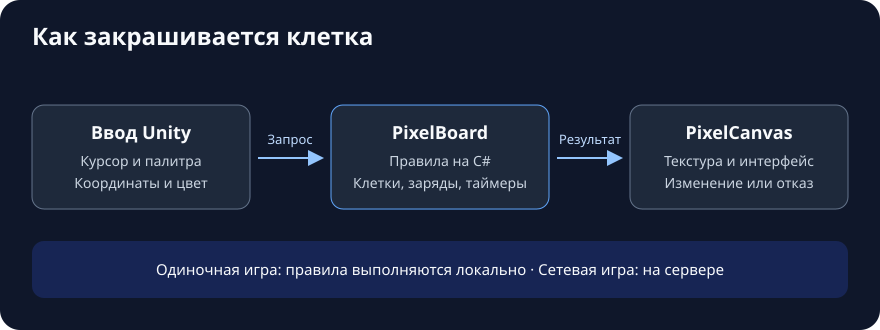

# Pixel Battle

Прототип 2D-игры про рисование на общем пиксельном полотне. Проект использует Unity 7, C# и новую Input System.

## Текущее состояние

В `Assets/Scenes/SampleScene.unity` есть 2D-камера, виртуальный курсор, Canvas и EventSystem. Полотно, правила покраски и мультиплеер пока в плане. Чтобы посмотреть текущий прототип, открой проект в Unity 7, загрузи `SampleScene` и нажми Play.

## Правила первого прототипа

- Полотно 64×64, палитра из 8 цветов. Один клик красит одну клетку. Повтор того же цвета не расходует краску.
- У игрока до 8 зарядов. Один заряд восстанавливается каждые 2 секунды.
- Свежий пиксель сохнет 3 секунды. В это время его нельзя перекрасить.
- Для раундов планируется тема и таймер на 5 минут. По окончании сохраняется изображение полотна.

## Архитектура

- **Ввод.** Существующий `VirtualCursorController` двигает курсор. Unity определяет клетку под ним и формирует запрос с координатами и выбранным цветом.
- **Правила.** Планируемый `PixelBoard` на чистом C# хранит клетки, время их покраски и запасы игроков. Он проверяет границы, цвет, высыхание и заряды. Успешная операция меняет цвет и списывает заряд вместе. Отказ возвращает причину.
- **Отображение.** Планируемый `PixelCanvas` связывает игру с Unity, обновляет текстуру с фильтрацией Point и передаёт результат в интерфейс. Размер полотна, палитра и таймеры задаются настройками матча.
- **Мультиплеер.** Сервер связывает запрос с игроком, задаёт игровое время и применяет запросы по очереди. При подключении клиент получает снимок полотна, затем получает подтверждённые изменения в порядке применения.

## План разработки

1. **Одиночное полотно.** Подсветка клетки, палитра, покраска и индикатор зарядов.
2. **Проверка правил.** Два локальных игрока с отдельными запасами, проверка одновременных попыток перекрасить клетку и границ таймеров.
3. **Раунд.** Тема, отсчёт времени и сохранение итогового изображения.
4. **Сетевой прототип.** Серверная обработка запросов, подключение посреди матча и синхронизация полотна.
5. **Эксперименты с правилами.** Кисти и командные зоны после проверки базовой покраски.
